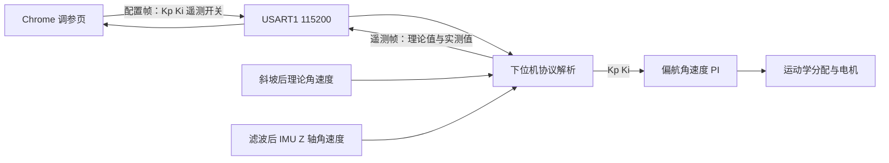

# 偏航角速度 PI 在线调参与遥测设计

## 目标

在现有偏航角速度闭环上加入网页在线调参能力：浏览器显示斜坡后的理论角速度与 IMU 实测角速度，并可在运行时修改 Kp/Ki。遥测必须由显式状态开关控制，默认关闭；关闭或调参页失联后，下位机停止上传。

## 现状与范围

`User/APP/chassis_task.c` 已经在 200 Hz 底盘任务中使用斜坡后的 `yaw_rate_applied` 与滤波后的 IMU Z 轴角速度比较，并将 PI 修正叠加到运动学前馈。默认 `Ki=0`。此次保留该控制结构，改为运行时参数并增加遥测和调参通信。

新增内容限于：USART1 收发调参协议、RAM 中的 PI 参数及遥测状态、非阻塞角速度上传、一个使用 Chrome Web Serial 的单页 HTML 调参界面及操作说明。页面仅负责遥测和参数配置，车辆运动继续使用现有控制源；调参时 USART1 由 Chrome 独占，车辆可由 SBUS 遥控。

## 数据流

## 串口帧

USART1 使用现有 `115200 8N1` 全双工连接。每帧固定 14 字节，浮点值为 IEEE-754 `float32` 小端。旧的 `A5 ... 4A` 运动控制帧不变；新调参帧使用 `C3` 帧头、`3C` 帧尾，与旧帧可在同一接收流中共存。CRC 使用 Modbus CRC-16（初值 `FFFF`、多项式 `A001`），低字节先发送，覆盖字节 1～10。

| 方向 | 字节布局 | 说明 |
| --- | --- | --- |
| 网页→下位机，配置 `0x01` | `C3 01 flags Kp[4] Ki[4] CRC[2] 3C` | `flags bit0=1` 开启遥测，`0` 关闭；每次配置可同时更新增益 |
| 下位机→网页，确认 `0x82` | `C3 82 status Kp[4] Ki[4] CRC[2] 3C` | 返回接受/拒绝及当前生效的增益 |
| 下位机→网页，遥测 `0x81` | `C3 81 seq target[4] actual[4] CRC[2] 3C` | 理论/实际角速度，单位 rad/s |

仅接受 CRC 正确、数值有限且处于配置范围内的增益。Kp 范围为 `0..2`，Ki 范围为 `0..1`；参数只保存在 RAM，重启后恢复头文件默认值。配置帧每 500 ms 心跳一次；遥测状态初始为关闭，1.5 s 未收到有效心跳自动关闭。遥测以 20 Hz 发送，使用 USART1 TX DMA；DMA 忙时跳过当前采样，不阻塞 5 ms 底盘控制周期。

## 网页界面

- 暗色实时曲线优先布局，显示理论角速度、IMU 实测角速度和误差；曲线保留最近 10 秒。
- 连接/断开串口、遥测开关、Kp/Ki 输入及应用按钮；显示连接状态和已确认生效的参数。
- 提供暂停/继续、清空曲线和 CSV 导出。
- 页面通过 Web Serial 以 115200 8N1 直连 USB 转串口。使用支持 Web Serial 的桌面 Chrome，并从 `localhost` 或 HTTPS 安全上下文打开。USB 虚拟串口由页面独占，不能同时被其他串口程序打开。
- 调参页面不发送运动指令。调参期间由 SBUS 遥控器提供车辆运动输入；CH8 控制源选择遵循现有逻辑。

## 错误处理

不支持 Web Serial 时显示浏览器提示；串口打开失败或断连时停止心跳、关闭页面遥测状态并提示重连。下位机对非法帧、越界增益和 CRC 错误不更新参数，并对有效配置请求返回状态确认。遥测只在状态开启期间发送；禁用或心跳超时立即停止发送。

## 验收标准

1. 默认上电且遥测未开启时，USART1 不输出角速度遥测帧。
2. 开启遥测后网页能以约 20 Hz 绘制理论值与 IMU 实测值，数值和误差同步更新；关闭开关或页面停止心跳后，遥测停止。
3. 网页应用合法 Kp/Ki 后，下位机确认值与 PI 实际使用值一致；非法、非有限或越界参数被拒绝。
4. 旧版 14 字节运动控制帧解析和既有控制源切换保持兼容；调参通信不阻塞底盘周期。
5. CSV 至少包含时间戳、理论角速度、实际角速度和误差。
